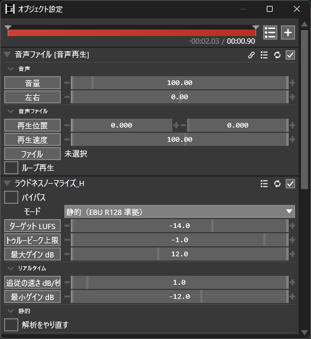

# LoudnessNormalize_H マニュアル



**ラウドネスノーマライズ_H**（LoudnessNormalize_H）は、音声オブジェクトの音量を **EBU R128 / ITU-R BS.1770-4** に沿って測り、指定したラウドネス（LUFS）にそろえる AviUtl2 用の音声フィルタ効果（Rust 製 `.auf2`）です。
「動画ごとに音の大きさがばらばら」「素材ごとに聞こえる大きさが違う」を、耳ではなく規格の物差しでそろえます。

- **バージョン:** 2.0.1
- **作者:** by HexBrowns
- **必要環境:** AviUtl ExEdit2（AviUtl2）**2.1.10** 以上（2.1.10 で確認）
- **ライセンス:** MIT

主な特徴:

- **実際に鳴っている音を測ります。** 分割・再生範囲・再生速度・上に掛けたフィルタ効果を通った後の音が対象です
- **音を潰しません。** 静的モードは 1 つの音量（ゲイン）を全体に掛けるだけで、強弱（ダイナミクス）は元のままです
- **歪ませません。** トゥルーピーク上限は音を切り落とす（クリップする）のではなく、「これ以上は上げない」という上限として使います

---

## 導入

1. GitHub の **Releases** から zip をダウンロードして展開する
2. 中の `Plugin` フォルダと `Language` フォルダを、AviUtl2 のデータフォルダ（既定は `C:\ProgramData\aviutl2`）へそのままコピーする
   - `Plugin\LoudnessNormalize_H\LoudnessNormalize_H.auf2`
   - `Language\English.loudness_normalize_h.aul2`（英語表示用。日本語で使うだけなら無くても動きます）
3. AviUtl2 を再起動する

---

## 使い方

### 1. 音声オブジェクトに掛ける

音声ファイルのオブジェクトを選び、設定ウィンドウでフィルタ効果を追加して **ラウドネスノーマライズ_H** を選びます。

既定の設定（静的モード・ターゲット -14.0 LUFS・トゥルーピーク上限 -1.0 dBTP）は、動画投稿サイト向けとして一般に知られている目安の値です（下の「目標値の目安」）。

### 2. 静的モード（既定）: 1 回最後まで通してから書き出す

静的モードは、規格どおりの「積分ラウドネス」（オブジェクト全体の平均的な大きさ）を測り、1 つのゲインを全体に掛けます。
**積分ラウドネスは全体を聞き終わるまで決まらない値**なので、次の流れになります。

| 順番 | すること | 何が起きるか |
|------|----------|--------------|
| 1 | オブジェクトの**頭から終わりまで**を 1 回通す（ファイル出力、または再生） | 通っている間は**素通し**（音量は変わらない）。測定が終わるとゲインが決まる |
| 2 | プロジェクトを**上書き保存**する | 測った値がプロジェクトに保存される。次に開いたときは測り直さずにすぐ効く |
| 3 | もう一度ファイル出力する | 決まったゲインが掛かった音で書き出される |

- **最初の 1 回の書き出しには効きません。** その書き出しは測定のための 1 周になり、音量はそろっていない状態で出力されます。書き出しは 2 回行ってください
- 全体の 98% 以上を通ると測定が確定します。途中で再生位置を飛ばすと、飛んだ直後の 0.2 秒ほどは測定に使わないので、その部分はもう一度通ったときに埋まります
- 保存しないまま AviUtl2 を終了すると測った値は消え、次はまた 1 周目からになります
- ゲインが決まった後で **ターゲット LUFS**・**トゥルーピーク上限 dBTP**・**最大ゲイン dB** を変えても、測り直しは要りません。すぐに新しい値で掛け直されます
- オブジェクトの長さ（またはサンプリングレート）が変わると、自動で測り直します
- 長さはそのままで中身が変わったとき（上に掛けたフィルタ効果を変えた、素材を差し替えた等）は自動では測り直しません。**静的 › 解析をやり直す** を使います（下記）
- 0.4 秒より短いオブジェクトは測れないので、素通しのままです

### 3. リアルタイムモード: 置いた瞬間から効く

**モード** を **リアルタイム（レベラー）** にすると、直近 3 秒の大きさ（Short-term ラウドネス）を見ながら、ゲインをゆっくり目標へ近づけます。放送で使われる自動音量調整（レベラー）と同じ考え方です。

- 事前に 1 周通す必要はありません
- **規格（R128）の積分ラウドネスでそろえるものではありません。** 書き出した音を測ると、ターゲットからずれることがあります。数値をきっちり合わせたいときは静的モードを使ってください
- ゲインは 0 dB から始まり、**追従の速さ dB/秒** を超える速さでは動きません。既定の 1 dB/秒で +9 dB 上げる必要がある素材なら、目標に届くまで 9 秒ほどかかり、その間は小さめに聞こえます
- 追従を速くするほど、大きい音と小さい音の差（ダイナミクス）が潰れます
- ほぼ無音（-70 LUFS 以下）の間はゲインを動かしません（ノイズを持ち上げないため）
- トゥルーピーク上限は「直近のピーク」を見て守ります。先読みをしないので、**音が急に立ち上がった瞬間だけは上限をわずかに超えることがあります**。上限を必ず守りたいときは静的モードを使ってください

---

## 設定項目

範囲はすべて 0.1 刻みです。英語表示のときの名前も併記します。

| 項目 | 範囲 | 初期値 | 説明 |
|------|------|--------|------|
| **バイパス**（Bypass） | ON / OFF | OFF | ON で何もせず素通しします。静的モードの測定も止まります |
| **モード**（Mode） | 静的（EBU R128 準拠） / リアルタイム（レベラー） | 静的（EBU R128 準拠） | 上の「使い方」を参照 |
| **ターゲット LUFS**（Target LUFS） | -40.0〜0.0 | -14.0 | そろえたい大きさ。下の「目標値の目安」を参照 |
| **トゥルーピーク上限 dBTP**（True Peak Ceiling (dBTP)） | -9.0〜0.0 | -1.0 | 掛けた後のトゥルーピーク（サンプルの間のピークまで含めた最大値）がこれを超えないように、ゲインを抑えます |
| **最大ゲイン dB**（Max Gain (dB)） | 0.0〜30.0 | 12.0 | 持ち上げすぎの歯止め。とても小さい素材を無理に上げてノイズまで大きくしないためのものです。**下げる方向は制限しません** |
| **リアルタイム › 追従の速さ dB/秒**（Realtime › Slew Rate (dB/s)） | 0.1〜12.0 | 1.0 | リアルタイムモードだけで使います。大きいほど速く追従し、ダイナミクスは潰れます |
| **リアルタイム › 最小ゲイン dB**（Realtime › Min Gain (dB)） | -30.0〜0.0 | -12.0 | リアルタイムモードで下げる量の下限。ただし**トゥルーピーク上限のほうが優先**されるので、ピークを守るためにこれより下がることがあります |
| **静的 › 解析をやり直す**（Static › Re-analyze） | ON / OFF | OFF | OFF から ON にした瞬間に、保存済みの測定値も含めて捨てて測り直します。ON のままにしておいても、繰り返し測り直すことはありません。もう一度やり直すときは OFF に戻してから ON にします |

### ゲインの決まり方（静的モード）

次の 3 つのうち**いちばん小さい値**が、実際に掛かるゲインです。

1. **ターゲット LUFS − 測った LUFS**（目標まで上げ下げする量）
2. **トゥルーピーク上限 dBTP − 測ったトゥルーピーク**（ピークが上限を超えない量）
3. **最大ゲイン dB**

2 が効いてターゲットに届かないときは、届かないままにします（音を歪ませてまで数字を合わせません）。そのときはログに「トゥルーピーク上限で頭打ち」と出ます。ピークの鋭い素材をもっと大きくしたい場合は、コンプレッサーやリミッターを先に掛けてから、このフィルタを掛けてください。

---

## 目標値の目安

**ここに挙げる値は、一般に知られている目安です。** 各サービスの基準は変わることがあり、公式に数値を公開していないものもあります。最新の値はそれぞれの案内で確かめてください。このプラグインが投稿先に合わせて値を選ぶことはありません。

| 用途 | ターゲット LUFS | トゥルーピーク上限 dBTP |
|------|-----------------|--------------------------|
| YouTube などの動画投稿サイト | -14 前後 | -1 |
| 音楽配信（Spotify など） | -14 前後 | -1 |
| ポッドキャスト | -16 前後 | -1 |
| 放送（EBU R128） | -23 | -1 |
| 日本の放送（ARIB TR-B32） | -24 | -1 |

- 投稿先で AAC などに圧縮されると、ピークがわずかに上がることがあります。圧縮で歪むのが気になるときは、トゥルーピーク上限を -2 程度に下げます
- 大きすぎる音を自動で下げる投稿サイトでは、ターゲットを上げても視聴者に届く大きさは変わらず、余裕（ダイナミクス）を失うだけになりがちです

---

## 効いているかの確かめ方

このプラグインは動作の状況を AviUtl2 のログに出します。**効いているかどうかは `適用:` または `リアルタイム:` の行で判断できます。** 出ていなければ、まだ掛かっていません。

```
[INFO] 静的: 解析開始 — 48000Hz / 総 2880000 サンプル / 600 パート / …
[INFO] 解析中: 50%（300/600 パート。全区間を通すとゲインが決まります） …
[INFO] 測定完了: -10.75 LUFS / -0.92 dBTP（カバー率 98.0%） …
[INFO] 適用: -3.25 dB (実測 -10.75 LUFS / -0.92 dBTP → ターゲット -14.0 LUFS) …
[INFO] 保存済みの測定値を使う: -10.75 LUFS / -0.92 dBTP …
[INFO] リアルタイム: ゲイン +4.20 dB（目標 +9.00 dB） …
```

| ログ | 意味 |
|------|------|
| `解析中: N%` | 静的モードで測定中。10% ごとに出ます。この間は素通し |
| `測定完了` | 測定が終わった。続けて `適用:` が出ます |
| `測定完了: 実質無音` | 測れる音が無かった。ゲインは掛けません |
| `適用: … 、トゥルーピーク上限で頭打ち` | ピークの上限が効いて、ターゲットまで届いていない |
| `保存済みの測定値を使う` | プロジェクトに保存された値を使った（測り直していない） |
| `オブジェクトの素性が変わったので測り直す` | 長さかサンプリングレートが変わったので、自動で測り直す |
| `静的: オブジェクトの総サンプル数が 0 で解析できない` | 静的モードでは測れない対象。リアルタイムモードを使ってください |

---

## v1 から移る方へ（v2 で変わったこと）

**測る対象を「ファイル」から「実際に鳴っている音」に変えました。**

v1 は「解析するファイル」に指定したファイルを直接読んで測っていました。これはファイルの音であってオブジェクトの音ではないので、分割・再生範囲・再生速度・上に掛けたフィルタ効果が反映されず、実際に聞こえる音とずれていました。v2 はオブジェクトから流れてくる音そのものを測ります。

- 「解析するファイル」欄は無くなりました
- リアルタイムモードを足しました
- 測った値をプロジェクトに保存するようにしました
- **設定項目が変わったため、v1 で保存したプロジェクトの設定は引き継がれません。** v1 を掛けたオブジェクトは、v2 で設定し直してください

---

## 注意事項・既知の制限

- **ラウドネスはオブジェクトごとに測ります。** 声と BGM を別々のオブジェクトにして、それぞれ -14 LUFS にそろえても、**混ぜた後の大きさは -14 LUFS になりません**（ほぼ必ずそれより大きくなります）。作品全体を正確に合わせたいときは、書き出した音を別の測定ソフトで確かめてください
- 静的モードは一度決まると自動では測り直しません（長さが変わったときを除く）。上流の加工を変えたら **解析をやり直す** を使ってください
- トゥルーピークの測り方は規格の手順を近似したもので、実際よりわずかに（最大 0.1 dB 程度）低く測ることがあります。ピークに余裕を持たせたいときは、上限を少し下げてください
- リアルタイムモードは、直前まで再生していた位置のゲインを引き継ぎます（再生位置を飛ばしても 0 dB に戻しません）。そのため同じ場所でも、どこから再生したかで聞こえる大きさが少し変わることがあります（作りの上での挙動。実機では確かめていません）

### 実機で確かめたこと（v2.0.1・AviUtl2 2.1.10）

- 60 秒・48kHz ステレオの音声ファイルに既定の設定（静的・ターゲット -14.0）を掛けて WAV で 2 回書き出し、2 回目が **-14.00 LUFS** になった（別の測定器 ffmpeg の `ebur128` で測定）
- 1 回目の書き出しは素通しで、その最後に測定が完了した
- ゲインは 1 回だけ掛かる（二重に掛かると約 -17.3 LUFS になるが、そうならなかった）
- プラグインの測定値（-10.75 LUFS / -0.92 dBTP）と ffmpeg の測定値（-10.80 LUFS / -0.90 dBTP）の差は 0.05 LU / 0.02 dB
- 保存していないプロジェクトは、AviUtl2 を再起動すると測定値が消えて 1 周目からになる

### 未確認

実機での確認がまだの項目です。うまくいかない場合は教えてください。

- **リアルタイムモード**（目標への追従、追従の速さ、最小ゲイン、トゥルーピーク上限の効き方）。机上の試験だけで、実機の書き出しでは測っていません
- **トゥルーピーク上限でゲインが頭打ちになる場合**の実際の出力
- **保存したプロジェクトを開き直したとき**に、測り直さずにすぐ効くか
- **書き出しではなくプレビュー再生で 1 周通した場合**に測定が完了するか（コマ落ちや再生速度の影響を含む）
- オブジェクトの **音量**（`音声再生` の項目）が、このフィルタの測定の前と後のどちらで掛かるか。後で掛かる場合、音量を変えるとその分だけターゲットからずれます
- 44.1kHz の素材・モノラルの素材での v2 の動作（v1 ではファイルを直接読む方法で確かめています）
- フィルタオブジェクトとして使う場合の動作
- 英語表示（`Language\English.loudness_normalize_h.aul2`）が設定画面に反映されるか

---

## 更新履歴

| 版 | 内容 |
|----|------|
| 2.0.1 | 静的モードは全体の 98% が揃えば測定を確定する。AviUtl2 2.1.10 以上向け |
| 2.0.0 | 測る対象を「ファイル」から「実際に鳴っている音」に変えた。リアルタイムモードを足した。測定値をプロジェクトに保存する。「解析するファイル」欄を廃止（v1 の設定は引き継がれない） |
| 1.2.0 | 掛けたゲインをログに出すようにした |
| 1.1.2 | 解析時間の集計が二重に数えられていたのを直した |
| 1.1.1 | 掛けると AviUtl2 が固まることがあったのを直した |
| 1.0.0 | 初版 |

---

## ライセンス

MIT License

Copyright (c) 2026 HexBrowns

全文は同梱の `LICENSE` を参照してください。
